# Retrieval before packet creation

The Chat Completions endpoint forwards the client's messages without adding retrieval context.
Use the task API when you want the workbench to retrieve evidence and prepare a new packet.

An existing workflow may already hash its context, limit allowed evidence IDs, or require a
reviewer to accept a specific revision. Adding retrieved text after that point breaks its
factual boundary. Select evidence before preparing that workflow's packet, or keep retrieval
as a separate proposal that the operator reviews.

```mermaid
flowchart LR
    Files[Explicitly selected local files] --> Index[Evidence RAG index]
    Index --> Search[BM25 and vector retrieval]
    Search --> Spans[Source spans and hashes]
    Spans --> Packet[Prepare a new task packet]
    Packet --> Model[Local Ollama model]
    Model --> Checks[Schema and citation checks]
    Checks --> Draft[Unreviewed draft]
    Draft --> Review[Operator review in the owning workflow]
```



## Evidence RAG connection

[Evidence RAG](https://github.com/oguzhanozfe/evidence-rag) is an independent companion
service. It can run on the Mac alongside this gateway while Ollama runs on either machine.
Each service can reach PC inference through the same SSH-forwarded loopback address.

The retrieval service defaults to approved, current sources:

```sh
curl http://127.0.0.1:8091/v1/search \
  -H 'Content-Type: application/json' \
  -d '{"query":"What evidence supports the release decision?","mode":"hybrid","limit":4,"approved_only":true,"statuses":["current"]}'
```

Treat `approved` as a corpus operator's label. In a career system, first filter the
authoritative claim registry to approved entries; labelling a file in this service does not
approve its claims. Keep application history, duplicate checks and permission decisions in
the owning application.

Retrieved spans retain their document hash, exact offsets and `complete:false`. Preserve
those fields when mapping to a client format. A retrieved paragraph is not a complete
document, and a source ID check is not a check that every generated statement follows from
that source.

## Local layout

Keep sibling checkouts and runtime data separate:

```text
projects/
  evidence-rag/       # Public code and synthetic examples
  local-workbench/    # Public code and synthetic examples
runtime/
  evidence.sqlite3   # Your local corpus, never published
  workbench/         # Operational measurements
private-corpus/      # Explicitly selected source documents
```

Index files through Evidence RAG's CLI before starting the services. The stack launcher
does not discover private files or ingest a whole repository:

```sh
export LOCAL_WORKBENCH_STATE="/absolute/runtime/workbench"
./scripts/start-stack.sh \
  /absolute/runtime/evidence.sqlite3 \
  /absolute/config/mac.json \
  /absolute/projects/evidence-rag
```

Use each project's `.venv` installation. Ctrl-C stops both application services. Ollama
has a separate lifecycle; the launcher expects it to be available already.
